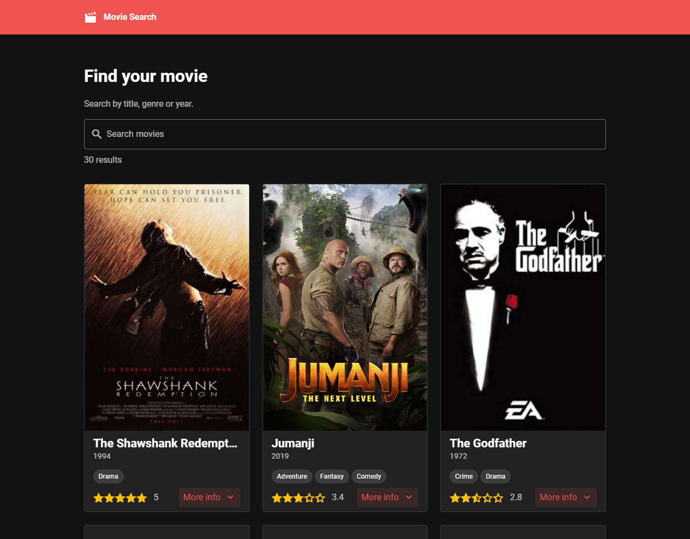
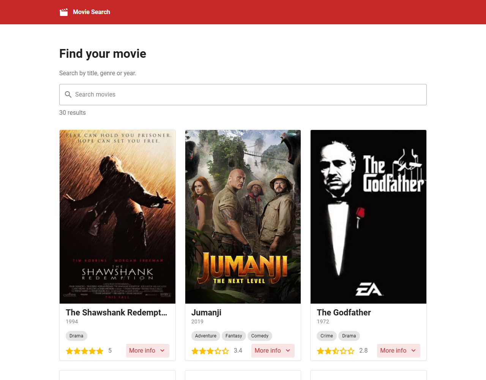
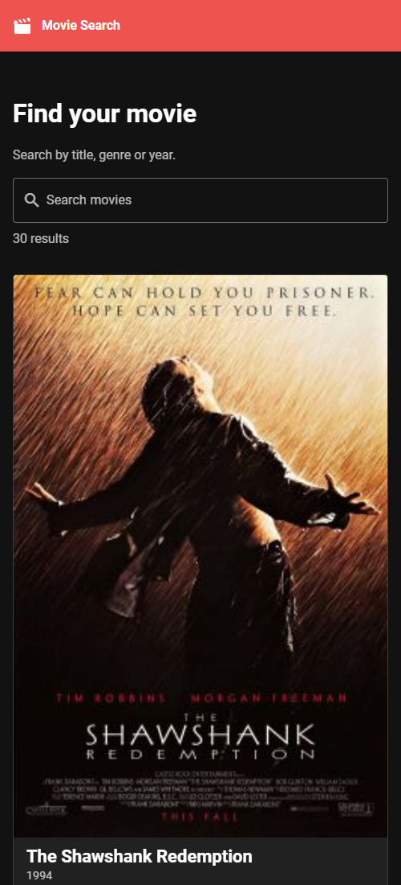

# 🎬 Movie Search

A responsive movie browser built with **Vue 3**, **Vuetify** and **Vite**. Search a catalog of movies by title, genre or year, browse the results in a paginated card grid and expand each card to read the synopsis.

**Live demo:** https://prochkoyatsko.github.io/movie-search-vuetify/



| Light theme | Mobile |
| --- | --- |
|  |  |

## Features

- **Instant search** by title, genre or release year
- **Responsive grid** – 1, 2 or 3 columns depending on screen size
- **Pagination** (9 movies per page), reset automatically on every new search
- **Expandable cards** with poster, genres, star rating and synopsis
- **Light / dark theme** following the operating system preference
- **Loading, empty and error states**, with a retry button if the API is unreachable

## Tech stack

| | |
| --- | --- |
| Framework | [Vue 3](https://vuejs.org/) (Composition API, `<script setup>`) |
| UI library | [Vuetify](https://vuetifyjs.com/) + [Material Design Icons](https://pictogrammers.com/library/mdi/) |
| Routing | [Vue Router](https://router.vuejs.org/) |
| Build tool | [Vite](https://vite.dev/) |
| Linting | [ESLint](https://eslint.org/) (`eslint-config-vuetify`) |
| Data | [DevsApiHub Movies API](https://devsapihub.com/) |

## Getting started

Requirements: [Node.js](https://nodejs.org/) 20.19+ and [pnpm](https://pnpm.io/).

```bash
git clone https://github.com/prochkoyatsko/movie-search-vuetify.git
cd movie-search-vuetify
pnpm install
pnpm dev
```

The app runs at http://localhost:3000.

## Scripts

| Command | Description |
| --- | --- |
| `pnpm dev` | Start the development server |
| `pnpm build` | Build for production into `dist/` |
| `pnpm preview` | Preview the production build locally |
| `pnpm lint` | Run ESLint |
| `pnpm lint:fix` | Run ESLint and fix issues automatically |

## Project structure

```
src/
├── App.vue                  # App shell (top bar + router view)
├── main.js                  # Entry point
├── components/
│   └── MovieCard.vue        # Movie card with expandable synopsis
├── pages/
│   └── index.vue            # Search page: search field, grid, pagination
├── plugins/
│   ├── index.js             # Plugin registration
│   └── vuetify.js           # Vuetify setup and theme colors
├── router/
│   └── index.js             # Routes (hash history, works on static hosting)
└── services/
    └── movieService.js      # API access and search filtering
```

## How it works

The full catalog is fetched once from the API when the page loads. Search filtering and pagination then run entirely on the client through Vue `computed` properties, so typing in the search box updates the results instantly without extra network requests.

## Deployment

The app uses relative asset paths and hash-based routing, so the contents of `dist/` can be served from any static host. A GitHub Actions workflow ([`.github/workflows/deploy.yml`](.github/workflows/deploy.yml)) lints, builds and publishes the app to GitHub Pages on every push to `main`.

## License

[MIT](LICENSE)
